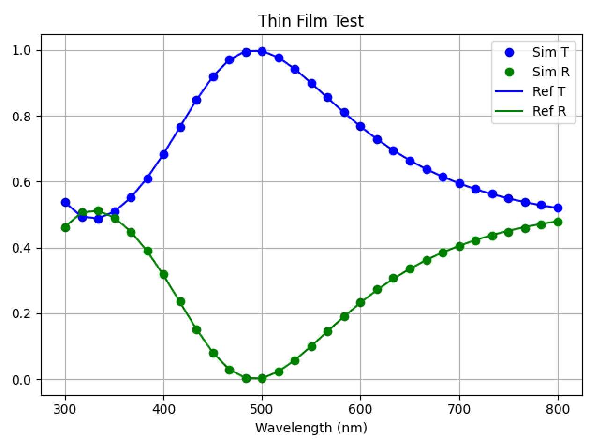
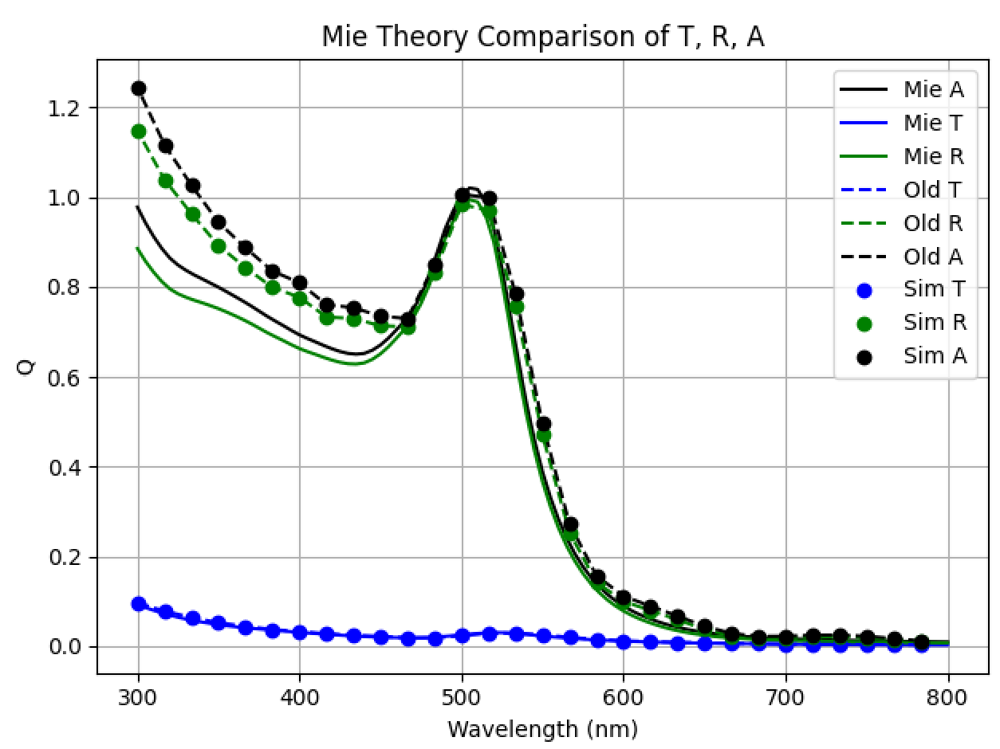
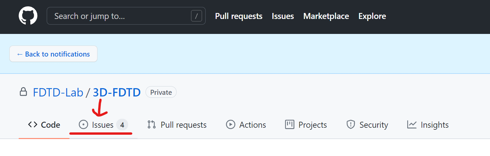
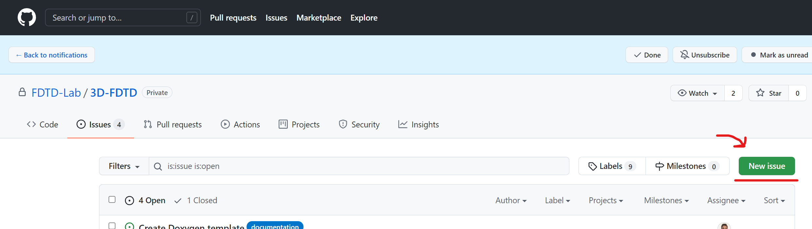
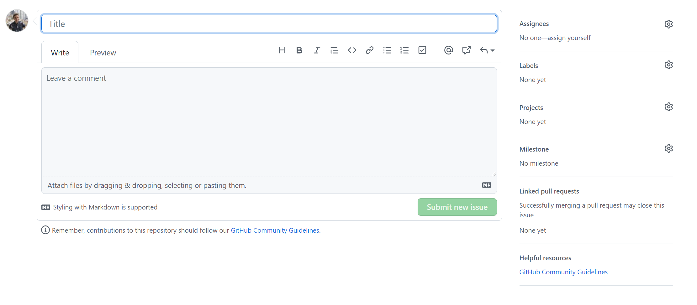
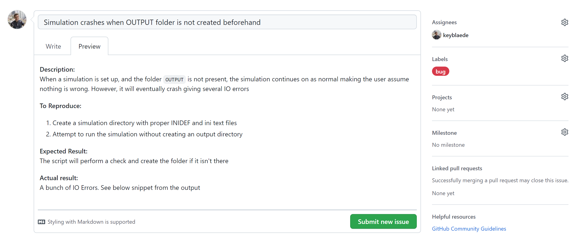

# Guide to Git and Contributing
 

## Contributing


### Before you start
1. Make sure you have access to the code and can build it ([Running a Simulation](../tutorial/CodeTutorial.md)).
2. Read the [Style Guide](StyleGuide.md) and the [Architecture](Architecture.md) page. **Keeping the code consistent greatly benefits its readability.** You will be asked to fix it before your code is accepted into the main branch if issues with readability are found.


### Development Process

1. **Create a New Branch**: After cloning the code, create a new branch. This keeps the `main` branch in working order. Once your edits are complete and error free, they can be merged into `main`.
```
git switch -c my-new-branch
```

2. **Pull from Main (daily)**: Keep your branch up to date with `main` by pulling from it often. This lets you handle conflicts as they appear.
```
git pull origin main
```

3. **Make your Edits**

4. **Test your code**: Run the checks of the [Testing](Tests.md) page: the unit tests, `make regression`, `make check-layers`. A refactoring must leave the results bit-identical; a change that is meant to move results is recorded in `docs/dev/Roadmap.md` §7 with its size before the references are updated.

5. **Update the Documentation**: `fdtd template` is generated from the code; the pages under `docs/` are not. Update the pages your change touches, and regenerate `docs/geometry/Shapes.md` (`docs/geometry/make_shape_figures.py`) when a shape or its keys change.

6. **Push your code**

7. **Submit a Pull Request**: Create a Pull Request on the website and assign a reviewer.


### Reference results of the analytical comparisons

Three regression cases have a `check.py` that compares a run with the analytical result
(`python3 test/regression/<case>/check.py <output directory>`). The values below are the ones
recorded when each test was created (2021-08-11); a change should give similar or better numbers.

**Empty Domain**
```
Max Deviation in R:     0.00000000
Mean Deviation in R:    0.00000000
```

**Thin Film**

A thin film 100 nm thick with a refractive index of 2.46.



```
Max Relative Deviation in T:    0.21%
Mean Relative Deviation in T:   0.13%
Max Absolute Deviation in T:    0.001829
Mean Absolute Deviation in T:   0.000927

Max Relative Deviation in R:    3.29%
Mean Relative Deviation in R:   0.81%
Max Absolute Deviation in R:    0.002307
Mean Absolute Deviation in R:   0.001294
```

**Mie Scattering**

Run the case with the 8000 steps of its `run.ini` (the regression suite shortens it to 1000). For
a good run time the example has a very coarse resolution (1 nm cells on a 20 nm sphere would need
many more steps and cells to converge), so the deviations from theory are large.



```
COMPARISON TO THEORY:
Max Relative Deviation in T:    12.28%
Mean Relative Deviation in T:   6.76%
Max Absolute Deviation in T:    0.005979
Mean Absolute Deviation in T:   0.001582

Max Relative Deviation in R:    73.82%
Mean Relative Deviation in R:   25.30%
Max Absolute Deviation in R:    0.263218
Mean Absolute Deviation in R:   0.062687

Max Relative Deviation in A:    61.35%
Mean Relative Deviation in A:   22.39%
Max Absolute Deviation in A:    0.267277
Mean Absolute Deviation in A:   0.064068
```

## Tickets/Issues

A ticket can be created for many things. Tickets are used to track everything from documenting code, implementing new features, and what bugs are currently found/being worked on.

### Creating a Ticket

To create a ticket, go to the FDTD git project and click on “Issues”:



In the new page that opens, click “New Issue”:



This will open the page to create a new ticket. The ticket creation tool looks as follows:




### Filling out the Ticket for a Bug Report

A bug report should be submitted whenever a bug is found. Even if the bug is small and can be fixed with relative ease, it's important that everyone is aware of any changes happening in the code. When a bug is found, a ticket should be submitted, assigned to the appropriate person, and fixed in a new branch.

Fill out the ticket accordingly:

1. Give it a clear title! Something which stands out just enough that it can be better discerned from other bugs. For example, something like "Simulation crashes with Even Numbers of Cores" is better than "Multiprocessing Error"
2. In the comment/description on the ticket be sure to include a description of the error, steps to reproduce the error, the expected result, and the actual result.
3. Set the ticket label to "Bug"
4. Assign the ticket to the person you believe will be the one to fix it! That includes yourself. If you guessed wrong the assignee will just reasssign the bug, and if you're unsure just assign it to Antonio or Josh and they can reassign it as needed.

Here is an example bug report:


