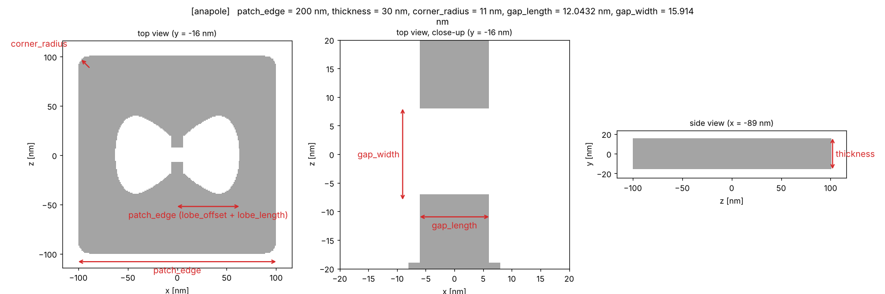

# Plasmonic anapole (`shape = anapole`)

A nanoantenna: a square silver patch with a dumbbell aperture, two lobes joined by a narrow gap,
after Hassan et al., *Anapole Plasmonic Meta-Atoms for Nearly Transparent Metamaterials*,
Laser Photonics Rev. 19, 2400118 (2025). The published design is 200 x 200 x 30 nm; its scattering
cross section has peaks near 580 and 985 nm and the anapole dip near 735 nm, where the field in the
gap is still enhanced about 30 times.



## Drawing

In the frame of the patch, `u` runs along the lobe axis and `v` across it; at `rotation = 0` they
are x and z, and the thickness is along y.

```cpp
patch    = rounded_rect(patch_edge, patch_edge, corner_radius)
gap      = rect(gap_length, gap_width)
lobe     = v = +-patch_edge lobe_height s^lobe_exponent sqrt(1 - s^2),  s = (|u| / patch_edge - lobe_offset) / lobe_length
           from the gap face |u| = gap_length / 2 to the tip |u| = patch_edge (lobe_offset + lobe_length)
aperture = the two lobes + gap
antenna  = extrude(patch - aperture, thickness), rotated by `rotation`
```

The shape is drawn with the geometry layers (`inc/geometry/csg.h`): rendered once from set
operations on primitives and sampled at the Yee position of each field component.

Where the lobes meet the gap they are wider than it, 37.5 nm against 15.9 nm with the defaults, so a
metal tooth stands on each side of the gap. The field enhancement of the paper is the average over
the 12 x 12 x 30 nm volume between the teeth.

## Keys

The material of the patch is `[geometry] material`. Its centre is the structure origin
(`[grid] origin_*`, the middle of the domain by default), moved along y by `[geometry] shift_y`.

| key | default | meaning |
|---|---|---|
| `patch_edge` | 200 nm | edge of the square patch |
| `thickness` | 30 nm | film thickness along y |
| `corner_radius` | 11 nm | fillet of the patch corners |
| `gap_length` | 12.0432 nm | gap between the lobes, along the lobe axis |
| `gap_width` | 15.914 nm | gap across the lobe axis, between the teeth |
| `lobe_length` | 0.433641 | length of the lobe curve, in units of `patch_edge` |
| `lobe_height` | 0.445090 | height coefficient of the lobe curve, in units of `patch_edge` |
| `lobe_exponent` | 1.4098 | exponent of the lobe curve |
| `lobe_offset` | -0.120141 | where the lobe curve starts, from the patch centre, in units of `patch_edge` |
| `rotation` | 0 | in-plane rotation in degrees |
| `aperture_material` | -1 | fill of the whole aperture, lobes and gap; -1 leaves the background |
| `gap_material` | -1 | fill of the gap alone; -1 leaves it as the rest of the aperture |
| `lobe_points` | 512 | polygon vertices per lobe edge, dense near the tip |

The defaults are the fit to the published 200 nm design. The lobe coefficients are in units of
`patch_edge`, so changing `patch_edge` scales the lobes with the patch; the gap and the corner radius
are absolute and stay as given. The corner radius is not part of the fit: 11 nm is read off the
figures of the paper.

The two fills cover the two cases of loading the antenna. `gap_material` puts a material between
the teeth only; `aperture_material` fills the lobes and the gap. With both set the gap takes
`gap_material`.

## Examples

`examples/anapole.ini` is the published case: the silver patch in air, a plane wave at normal
incidence polarised across the lobe axis, 400 to 1200 nm. It writes the cross sections, the field
in the plane of the patch, the field in the gap volume and the probe trace at the gap centre, and
lists the overrides for a filled gap or aperture, a glass substrate, a periodic metasurface and a
coarse first look.

```sh
./fdtd check  examples/anapole.ini
./fdtd signal examples/anapole.ini
./fdtd memory examples/anapole.ini
mpirun -n 8 ./fdtd mesh     examples/anapole.ini -o out/anapole
mpirun -n 8 ./fdtd simulate examples/anapole.ini -o out/anapole
```

The polarisation matters: `[plane_wave] polarization_axis = z` puts E across the lobe axis and
drives the gap, which is the anapole case; `x` puts E along the lobes and the dip disappears.

The exact multipole decomposition, `[multipoles] exact = true`, is off in the example: it keeps a
DFT of the current in the whole domain at every wavelength, 37 GiB with the grid and the 81
wavelengths of the example. Lower `[spectrum] points` and ask `fdtd memory` before turning it on.

### Filling the aperture with ITO

`examples/anapole_ito.ini` is the same case with ITO in the lobes and the gap:

```ini
[geometry]
shape = anapole
material = 101               ; silver patch

[anapole]
aperture_material = 153      ; ITO in the lobes and the gap
gap_material = -1            ; 153 here and -1 above fills the gap alone

[materials]
carrier_density = 1.054e27   ; free carriers of the ITO, m^-3
```

Codes 151, 153 and 155 are Drude fits of ITO whose plasma frequency follows
`[materials] carrier_density` ([Materials](../models/Materials.md)). With code 153 and
1.054e27 m^-3 the permittivity of the fill falls from 3.3 at 500 nm through 2.5 at 735 nm to zero
near 1240 nm: the fill is a dielectric at the anapole dip and approaches epsilon-near-zero at the
long-wavelength resonance. The carrier density moves that crossing.

## Agreement with the paper

The outline is a fit to the published drawing, and the fit shifts the spectrum to the red: expect
the dip and the peaks some tens of nm above the 735, 580 and 985 nm of the paper. A check run of
the default shape gives:

| cells | dip | peaks |
|---|---|---|
| paper | 735 nm | 580 and 985 nm |
| 2 nm | 800 nm | 640 and 1060 nm |
| 4 nm | 880 nm | 680 and 1100 nm |

The spectrum has the shape of the paper, two peaks with a dip between them where the scattering
efficiency falls below 0.03 against 4 to 9 at the peaks. The positions still move with the cell
size, so part of the shift at 2 nm is the grid and not the fit. Both runs sampled every 20 nm, and
the 2 nm run used a domain smaller than the example, 280 x 120 x 280 nm.

## Checks

`test/test_geometry.cc` compares the rendered patch with a point-wise predicate of the same outline
on a 1 nm grid: 130032 cells of the 400 nm variant, none differ. The regression case
`test/regression/Anapole` is that variant, a silver patch scaled to 400 nm in air on glass.
