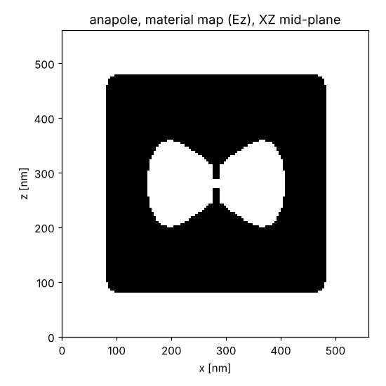

# Plasmonic anapole (`shape = anapole`)

A nanoantenna: a gold/silver patch with a dumbbell aperture, after Hassan et al., ported from the COMSOL model
`plasmonic_anapole.mph`. It is the first shape drawn with the geometry layers
(`inc/geometry/csg.h`): rendered once from set operations on primitives, sampled at the Yee position of
each field component.

```cpp
patch    = rounded_rect(w, w, corner_radius)
lobe     = polygon(v = +-w B s^p sqrt(1 - s^2), s = (u/w - X0)/A, neck_half_length <= u <= w (X0 + A))
aperture = lobe + mirror(lobe) + rect(2 neck_half_length, 2 neck_half_height)
antenna  = extrude(patch - aperture, thickness), rotated by `rotation`
```


The material of the patch is `[geometry] material`; its centre is the domain centre (`[grid] origin_*`),
shifted along y by `[geometry] shift_y`. The lobes and the neck stay background unless
`lobe_material` / `neck_material` are set; `dimer_material` adds two cylinders of radius
`dimer_radius` and gap `dimer_gap` in the neck.

| key | default | meaning |
|---|---|---|
| `patch_edge` | 400 nm | edge of the square patch (`w`) |
| `thickness` | 30 nm | film thickness along y |
| `corner_radius` | 22 nm | fillet of the patch corners |
| `lobe_a`, `lobe_b`, `lobe_p`, `lobe_x0` | 0.433641, 0.445090, 1.4098, -0.120141 | lobe length, height, exponent, start, in units of `w` |
| `neck_half_length`, `neck_half_height` | 6.0216 nm, 7.957 nm | neck, absolute (fixed by fabrication) |
| `rotation` | 0 | in-plane rotation [deg] |
| `lobe_material`, `neck_material`, `dimer_material` | -1 | fills; -1 = background / none |
| `dimer_radius`, `dimer_gap` | 2.5 nm, 2 nm | |
| `lobe_points` | 512 | polygon vertices per lobe edge (dense near the tip) |

The defaults are the COMSOL revision with `s0 = 2`. Between the lobes and the neck there is a metal
"tooth": the lobe edge is cut by the neck face `|u| = neck_half_length`, where the lobe half-height
(32.7 nm with the defaults) exceeds the neck half-height.



Checks: `test/test_geometry.cc` compares the rendered patch with the original point-wise predicate on
a 1 nm grid (130032 cells, 0 differ); a 1-rank and a 2-rank run are bit-identical.

## Model notes (from the original draft)

The aperture is modelled as a dumbbell: two mirror-symmetric lobes joined by a narrow rectangular gap, cut through a square Ag patch of edge $w$. Each lobe boundary follows $y = \pm B\,u^{p}\sqrt{1-u^{2}}$ with $u = (|x| - X_0)/A$ and $0 \le u \le 1$, where all lengths are in units of $w$ so that the shape is independent of scale; $p = 2$ gives the classical dumbbell sextic. $X_0$ is where the lobe starts, $A$ its length and $B$ its height. The coefficients were fitted to binary masks traced from the published figures of Hassan et al. (fit RMS below 0.5 nm). We held $p = 2$ fixed because it trades off almost exactly against $A$ and $X_0$, so fixing it keeps designs comparable. The lobe maximum, at $u_m = \sqrt{2/3}$ and $y_m = 0.385B$, is then used as the design handle in polar form ($r_m$, $\theta_m$), with $X_0$ and $B$ derived from it and $A$ kept at its fitted value. Further assumptions: the aperture is symmetric about both axes (half is drawn, then mirrored); its walls are vertical (a 2D outline extruded through the film); the lobe is truncated where it meets the gap face. The gap is held at its fitted absolute size ($12 \times 15.9$ nm) rather than scaled with $w$, as fabrication would fix it. The patch corners are rounded with a fitted radius that scales with $w$. This model describes the published shape class; it is not a general parametrisation of all possible apertures.

Note: these notes fix `p = 2` and use the lobe maximum in polar form as the design handle, while the
COMSOL defaults above use the fitted `p = 1.4098` and the raw coefficients. The keys expose the raw
coefficients; a polar-form binding (`r_m`, `theta_m`) can be added on top when the design study needs it.

Regression case: `test/regression/Anapole` (silver patch in air on glass, plane wave from the air side).
