# Shapes

Generated by `docs/geometry/make_shape_figures.py`; do not edit.

`[geometry] shape = <name>` selects the structure and `[<name>]` holds its dimensions. Each figure is the
mesh the solver builds for the values in its title (1 nm cells), cut through the structure, with the
keys drawn on it. The structure is centred on `[grid] origin_x`, `origin_z`; `[geometry] shift_y` moves it
along y. Setting a key in the section of another shape is an error.

## sphere

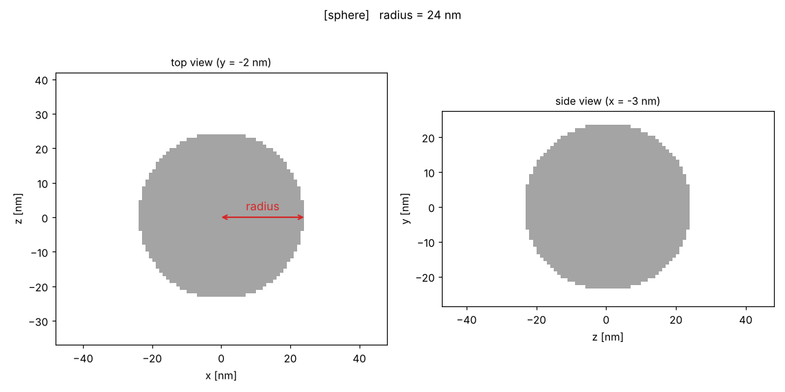

| key | meaning |
|---|---|
| `radius` | [m] |

## sphere_shell

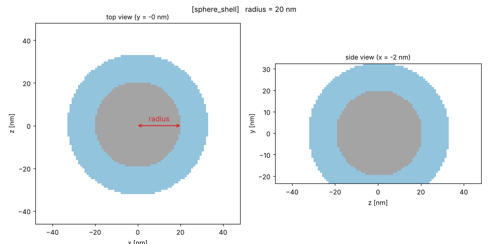

| key | meaning |
|---|---|
| `radius` | [m] radius of the core; the shell of [geometry] shell_material is 13 cells thicker |

## two_spheres


| key | meaning |
|---|---|
| `radius` | [m] |
| `separation` | [m] centre to centre, along y |

## sphere_dimer

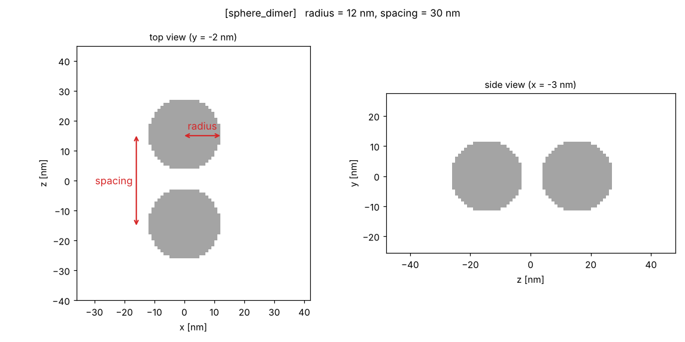

| key | meaning |
|---|---|
| `radius` | [m] |
| `spacing` | [m] centre to centre, along z |

## sphere_trimer


| key | meaning |
|---|---|
| `radius` | [m] |
| `spacing` | [m] centre to centre, along z |

## sphere_quadrumer

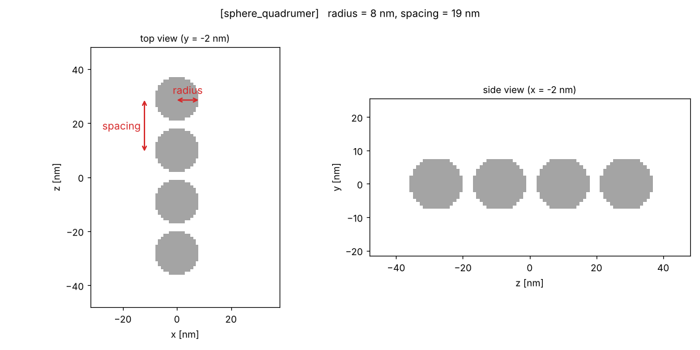

| key | meaning |
|---|---|
| `radius` | [m] |
| `spacing` | [m] centre to centre, along z |

## cylinder


| key | meaning |
|---|---|
| `radius` | [m] cylinder along z |
| `length` | [m] along z; 0 = through the whole domain |

## cylinder_shell

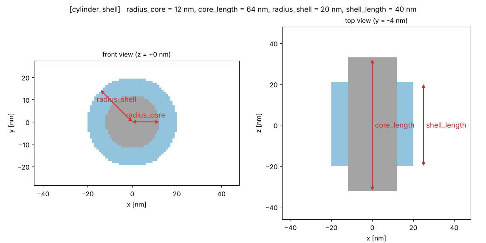

| key | meaning |
|---|---|
| `radius_core` | [m] radius of the core; both cylinders are along y, on the same axis |
| `core_length` | [m] of the core along y; 0 = through the whole domain |
| `radius_shell` | [m] outer radius of the shell of [geometry] shell_material; the core is drawn over it |
| `shell_length` | [m] of the shell along y; 0 = through the whole domain; shorter than the core leaves the core ends bare |

## ellipse


| key | meaning |
|---|---|
| `radius_x` | [m] semi-axis along x |
| `radius_z` | [m] semi-axis along z |
| `thickness` | [m] along y |
| `rotation` | [deg] positive turns counter-clockwise in the top view, x right and z up |

## cylinder_3d


| key | meaning |
|---|---|
| `radius` | [m] disc in the x-z plane |
| `height` | [m] along y |

## dipole


| key | meaning |
|---|---|
| `width` | [m] arm width, along x |
| `thickness` | [m] along y |
| `gap` | [m] between the arms, along z |
| `top_end` | [m] end of the top arm along +z, measured from the centre of the gap |
| `bottom_end` | [m] end of the bottom arm along -z, measured from the centre of the gap |

## bowtie


| key | meaning |
|---|---|
| `width` | [m] base of each triangle, along x |
| `thickness` | [m] along y |
| `length` | [m] base to base, along z |
| `gap` | [m] between the tips |

## triangle


| key | meaning |
|---|---|
| `width` | [m] base, along x |
| `thickness` | [m] along y |
| `length` | [m] base to apex, along z |

## rounded_triangle

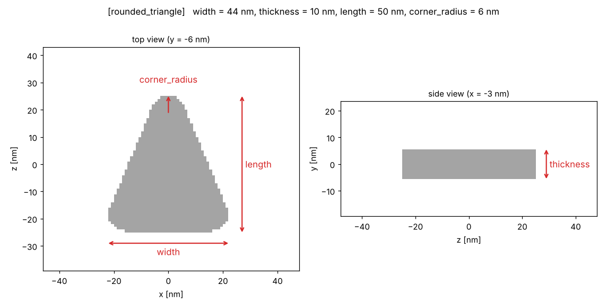

| key | meaning |
|---|---|
| `width` | [m] outer size along x |
| `thickness` | [m] along y |
| `length` | [m] outer size along z |
| `corner_radius` | [m] |

## rounded_monopole


| key | meaning |
|---|---|
| `width` | [m] along x |
| `thickness` | [m] along y |
| `length` | [m] along z |
| `corner_radius` | [m] of the four vertical edges |

## rounded_dipole

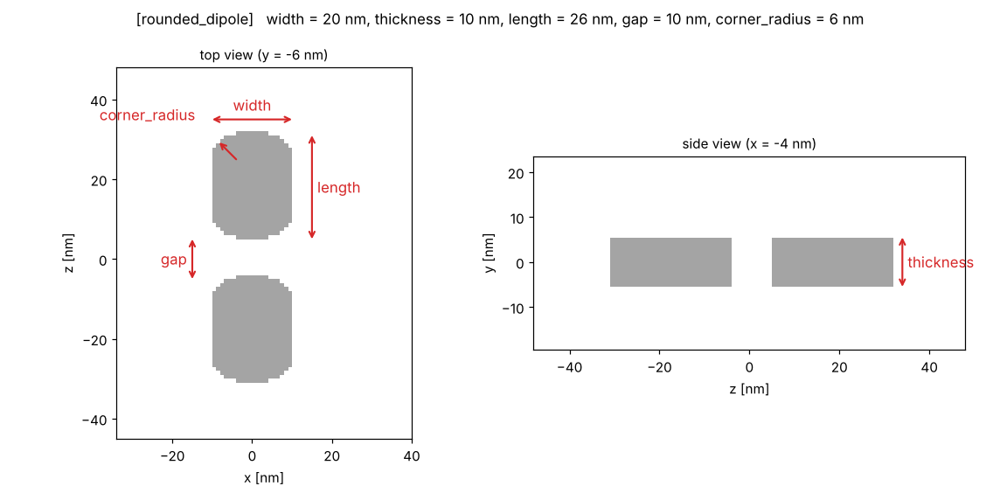

| key | meaning |
|---|---|
| `width` | [m] arm width, along x |
| `thickness` | [m] along y |
| `length` | [m] of each arm, along z |
| `gap` | [m] between the arms |
| `corner_radius` | [m] of the vertical edges |

## rounded_dipole_offset_planes

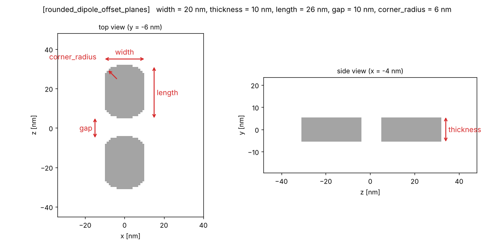

| key | meaning |
|---|---|
| `width` | [m] arm width, along x |
| `thickness` | [m] along y |
| `length` | [m] of each arm, along z |
| `gap` | [m] between the arms |
| `corner_radius` | [m] of the vertical edges |

## round_dipole

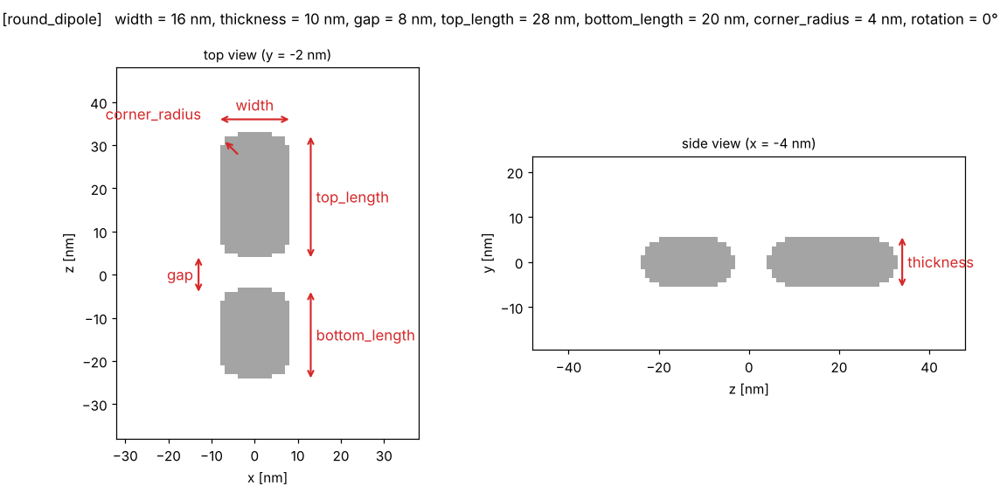

| key | meaning |
|---|---|
| `width` | [m] arm width |
| `thickness` | [m] along y |
| `gap` | [m] between the arms |
| `top_length` | [m] length of the top arm |
| `bottom_length` | [m] length of the bottom arm |
| `corner_radius` | [m] of every edge |
| `rotation` | [deg] 0: arms along z; positive turns counter-clockwise in the top view, x right and z up |

## one_side_round_dipole

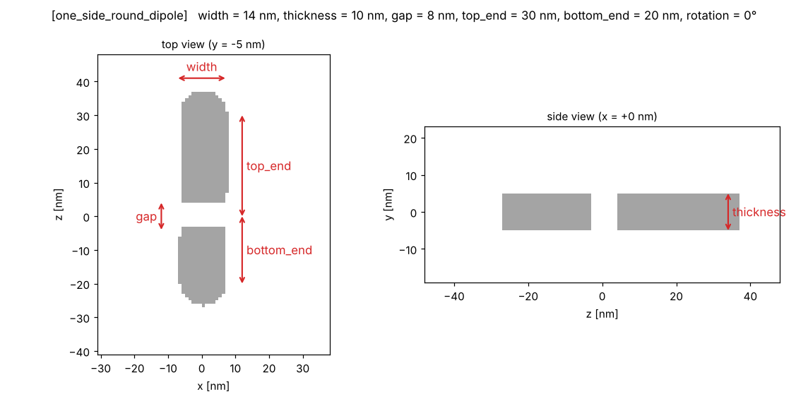

| key | meaning |
|---|---|
| `width` | [m] arm width; the outer ends are half discs of this diameter |
| `thickness` | [m] along y |
| `gap` | [m] between the arms |
| `top_end` | [m] centre of the top end disc, measured from the centre of the gap |
| `bottom_end` | [m] centre of the bottom end disc, measured from the centre of the gap |
| `rotation` | [deg] 0: arms along z; positive turns counter-clockwise in the top view, x right and z up |

## round_hybrid


| key | meaning |
|---|---|
| `width` | [m] arm width |
| `thickness` | [m] along y |
| `gap` | [m] between the arms, filled with the gap material |
| `arm_length` | [m] length of each arm |
| `corner_radius` | [m] of every edge |
| `rotation` | [deg] 0: arms along z; positive turns counter-clockwise in the top view, x right and z up |

## hole


| key | meaning |
|---|---|
| `radius` | [m] of the hole |
| `thickness` | [m] of the film that fills the x-z plane, along y |

## u_shape


| key | meaning |
|---|---|
| `width` | [m] width of the three bars |
| `thickness` | [m] along y |
| `length` | [m] outer size along z |
| `arm_length` | [m] of the two arms along x, beyond the base bar |
| `corner_radius` | [m] |

## h_shape

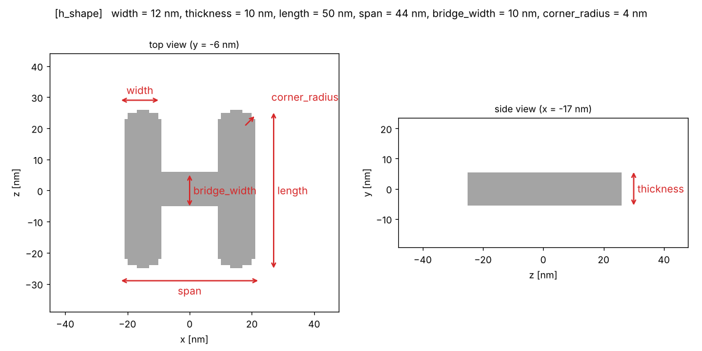

| key | meaning |
|---|---|
| `width` | [m] width of the two bars, along x |
| `thickness` | [m] along y |
| `length` | [m] of the two bars, along z |
| `span` | [m] outer size along x |
| `bridge_width` | [m] size of the bridge along z |
| `corner_radius` | [m] |

## v_shape

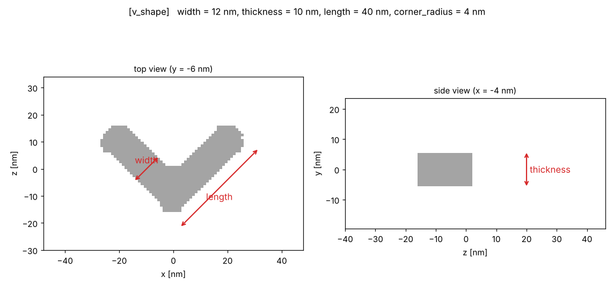

| key | meaning |
|---|---|
| `width` | [m] arm width |
| `thickness` | [m] along y |
| `length` | [m] arm length |
| `corner_radius` | [m] |

## l_shape

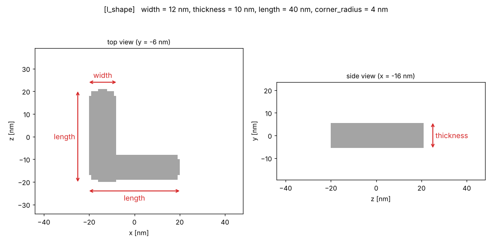

| key | meaning |
|---|---|
| `width` | [m] arm width |
| `thickness` | [m] along y |
| `length` | [m] arm length |
| `corner_radius` | [m] |

## l_antenna

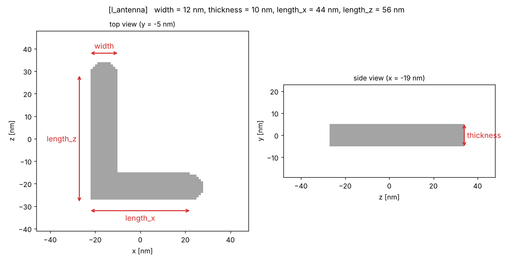

| key | meaning |
|---|---|
| `width` | [m] width of the two bars |
| `thickness` | [m] along y |
| `length_x` | [m] of the bar along x at the -z end, from the outer corner to the centre of its round end |
| `length_z` | [m] of the bar along z at the -x end, from the outer corner to the centre of its round end |

## lateral_dipole


| key | meaning |
|---|---|
| `width` | [m] width of each bar, along x |
| `thickness` | [m] along y |
| `gap` | [m] between the two bars, along x |
| `left_length` | [m] of the bar at -x; it reaches toward +z |
| `right_length` | [m] of the bar at +x; it reaches toward -z |
| `overlap` | [m] length along z over which the two bars face each other; the facing corners are cut at 45 deg |

## round_butterfly

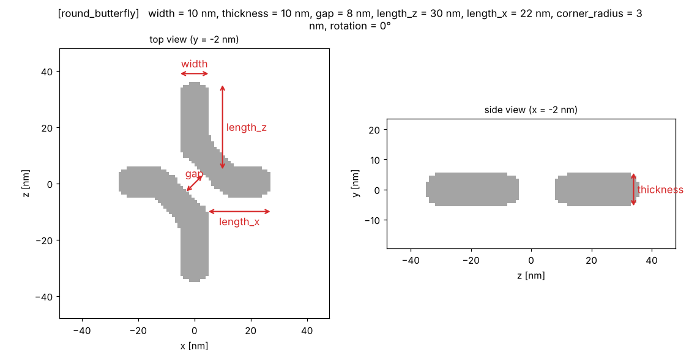

| key | meaning |
|---|---|
| `width` | [m] bar width |
| `thickness` | [m] along y |
| `gap` | [m] between the two halves; each half is one z bar and one x bar joined by a diagonal neck |
| `length_z` | [m] of each bar along z, measured from width / 2 off the centre |
| `length_x` | [m] of each bar along x, measured the same way |
| `corner_radius` | [m] of every edge and of the two arcs |
| `rotation` | [deg] 0: bars along x and z; positive turns counter-clockwise in the top view, x right and z up |

## round_tripole


| key | meaning |
|---|---|
| `width` | [m] bar width |
| `thickness` | [m] along y |
| `center_length` | [m] of the middle bar; the three bars are in line |
| `top_length` | [m] of the top bar, along +z at rotation 0 |
| `bottom_length` | [m] of the bottom bar |
| `top_gap` | [m] between the middle and the top bar |
| `bottom_gap` | [m] between the middle and the bottom bar |
| `corner_radius` | [m] of every edge |
| `rotation` | [deg] 0: bars along z; positive turns counter-clockwise in the top view, x right and z up |

## x_shape


| key | meaning |
|---|---|
| `thickness` | [m] along y |
| `fixed_length` | [m] of the fixed bar, along x |
| `fixed_width` | [m] of the fixed bar |
| `rotated_length` | [m] of the second bar, which crosses the fixed one at its centre |
| `rotated_width` | [m] of the second bar |
| `corner_radius` | [m] of every edge |
| `angle` | [deg] from the fixed bar to the second bar, counter-clockwise in the top view, x right and z up; 90 is a cross |

## anapole

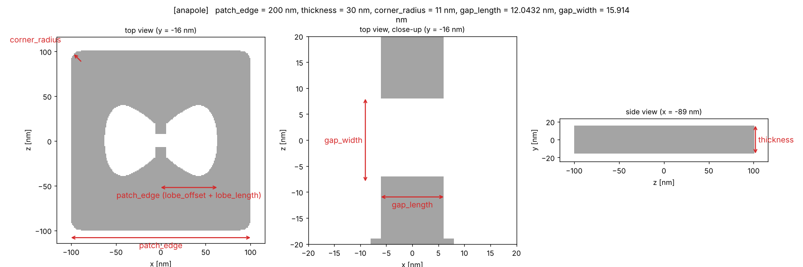

| key | meaning |
|---|---|
| `patch_edge` | [m] edge of the square patch |
| `thickness` | [m] film thickness along y |
| `corner_radius` | [m] fillet radius of the patch corners |
| `lobe_length` | length of the lobe curve, in units of patch_edge |
| `lobe_height` | height coefficient of the lobe curve, in units of patch_edge |
| `lobe_exponent` | exponent of the lobe curve |
| `lobe_offset` | where the lobe curve starts, from the patch centre, in units of patch_edge |
| `gap_length` | [m] gap between the lobes, along the lobe axis |
| `gap_width` | [m] gap across the lobe axis |
| `rotation` | [deg] in-plane rotation, x-z |
| `aperture_material` | fill of the whole aperture, lobes and gap, a material name; unset = background |
| `gap_material` | fill of the gap alone, a material name; unset = as the rest of the aperture |
| `lobe_points` | polygon vertices per lobe edge |

A square patch with a dumbbell aperture, two lobes joined by a narrow gap, after Hassan et al.,
*Anapole Plasmonic Meta-Atoms for Nearly Transparent Metamaterials*, Laser Photonics Rev. 19,
2400118, 2025. The published design is a 200 x 200 x 30 nm silver patch: its scattering cross
section peaks near 580 and 985 nm, with the anapole dip near 735 nm, where the field in the gap is
still enhanced about 30 times. The patch material is `[geometry] material`.

In the frame of the patch, u runs along the lobe axis and v across it; at `rotation = 0` they are x
and z, and the thickness is along y:

```
patch    = rounded_rect(patch_edge, patch_edge, corner_radius)
gap      = rect(gap_length, gap_width)
lobe     = v = +-patch_edge lobe_height s^lobe_exponent sqrt(1 - s^2),  s = (|u| / patch_edge - lobe_offset) / lobe_length
           from the gap face |u| = gap_length / 2 to the tip |u| = patch_edge (lobe_offset + lobe_length)
aperture = the two lobes + gap
antenna  = extrude(patch - aperture, thickness), rotated by rotation
```

The drawing is `geom::anapole_parts`, `inc/geometry/drawings.h`. Staircased, a cell takes a material
when its centre is inside.

- The defaults are the fit to the published design. The lobe keys are in units of `patch_edge`, so
  changing it scales the lobes with the patch; the gap and the corner radius are absolute. The corner
  radius, 11 nm, is read off the figures of the paper and is not part of the fit.
- Where the lobes meet the gap they are wider than it, 37.5 nm against 15.9 nm with the defaults, so
  a metal tooth stands on each side of the gap. The field enhancement of the paper is the average
  over the 12 x 12 x 30 nm volume between the teeth.
- `gap_material` fills the gap between the teeth only, `aperture_material` the lobes and the gap;
  with both set the gap takes `gap_material`. Both count as structure in the multipole volume.
- The polarisation matters: `[plane_wave] polarization_axis = z` puts E across the lobe axis and
  drives the gap, the anapole case; `x` puts E along the lobes and the dip disappears.

`examples/anapole.ini` is the published case: the silver patch in air, normal incidence, 400 to
1200 nm, with the cross sections, the field in the plane of the patch and in the gap volume, and the
probe at the gap centre; it lists the overrides for a filled gap or aperture, a glass substrate, a
periodic metasurface and a coarse first look. `examples/anapole_ito.ini` fills the aperture with ITO:

```ini
[anapole]
aperture_material = ito      ; ITO in the lobes and the gap
; gap_material = ito         ; instead: the gap alone

[material.ito]
extends = ito_10p5_drude
carrier_density = 1.054e27   ; free carriers, m^-3
```

The ITO Drude materials take their plasma frequency from `carrier_density`. With 1.054e27 m^-3 the
permittivity of the fill falls from 3.3 at 500 nm through 2.5 at 735 nm to zero near 1240 nm: a
dielectric at the anapole dip, epsilon near zero at the long-wavelength resonance.

The exact multipoles are off in the example: they keep a DFT of the field in the whole domain at
every wavelength, 37 GiB with its grid and 81 wavelengths. Lower `[spectrum] points` and ask
`fdtd memory` first.

The fit shifts the spectrum to the red: expect the dip and the peaks some tens of nm above the paper.

| cells | dip | peaks |
|---|---|---|
| paper | 735 nm | 580 and 985 nm |
| 2 nm | 800 nm | 640 and 1060 nm |
| 4 nm | 880 nm | 680 and 1100 nm |

The positions still move with the cell size, so part of the shift at 2 nm is the grid. Both runs
sampled every 20 nm; the 2 nm run used a smaller domain than the example, 280 x 120 x 280 nm.
`test/test_geometry.cc` compares the rendered patch with a point-wise predicate of the outline on a
1 nm grid, 130032 cells, none differ; the regression case `test/regression/Anapole` is that patch
scaled to 400 nm, silver in air on glass.

## two_films_spacer

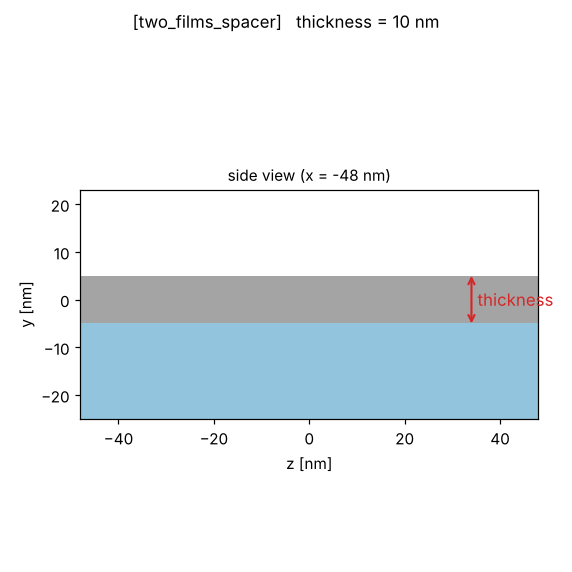

| key | meaning |
|---|---|
| `thickness` | [m] of the film, along y |
