# Shapes

Generated by `docs/geometry/make_shape_figures.py`; do not edit.

`[geometry] shape = <name>` selects the structure and `[<name>]` holds its dimensions. Each figure is the
mesh the solver builds for the values in its title (1 nm cells), cut through the structure, with the
keys drawn on it. The structure is centred on `[grid] origin_x`, `origin_z`; `[geometry] shift_y` moves it
along y. Setting a key in the section of another shape is an error.

## sphere

| key | meaning |
|---|---|
| `radius` | [m] |

## sphere_shell

| key | meaning |
|---|---|
| `radius` | [m] radius of the core; the shell ([geometry] shell_material) is 13 cells thicker |

## two_spheres

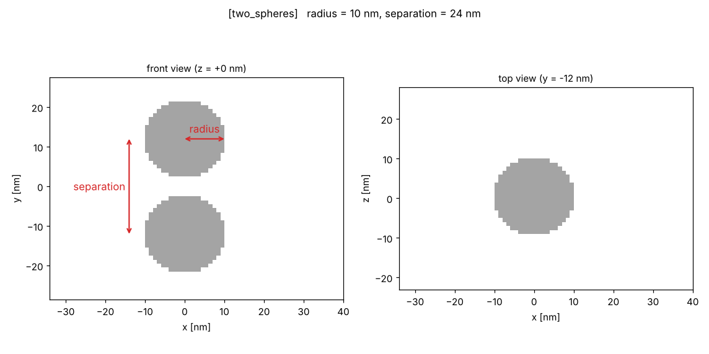

| key | meaning |
|---|---|
| `radius` | [m] |
| `separation` | [m] centre to centre, along y |

## sphere_dimer

| key | meaning |
|---|---|
| `radius` | [m] |
| `spacing` | [m] centre to centre, along z |

## sphere_trimer

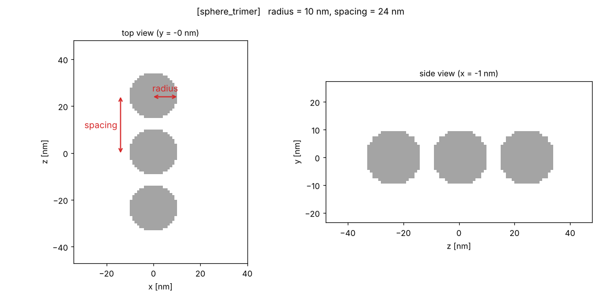

| key | meaning |
|---|---|
| `radius` | [m] |
| `spacing` | [m] centre to centre, along z |

## sphere_quadrumer

| key | meaning |
|---|---|
| `radius` | [m] |
| `spacing` | [m] centre to centre, along z |

## cylinder

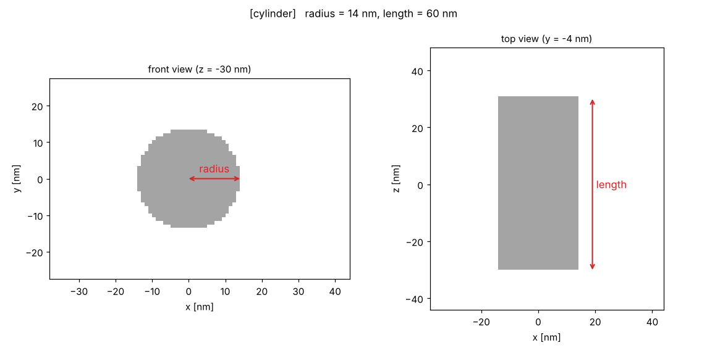

| key | meaning |
|---|---|
| `radius` | [m] cylinder along z |
| `length` | [m] along z; 0 = through the whole domain |

## cylinder_shell

| key | meaning |
|---|---|
| `radius_core` | [m] radius of the core; both cylinders are along y, on the same axis |
| `core_length` | [m] of the core along y; 0 = through the whole domain |
| `radius_shell` | [m] outer radius of the shell ([geometry] shell_material); the core is drawn over it |
| `shell_length` | [m] of the shell along y; 0 = through the whole domain; shorter than the core leaves the core ends bare |

## ellipse

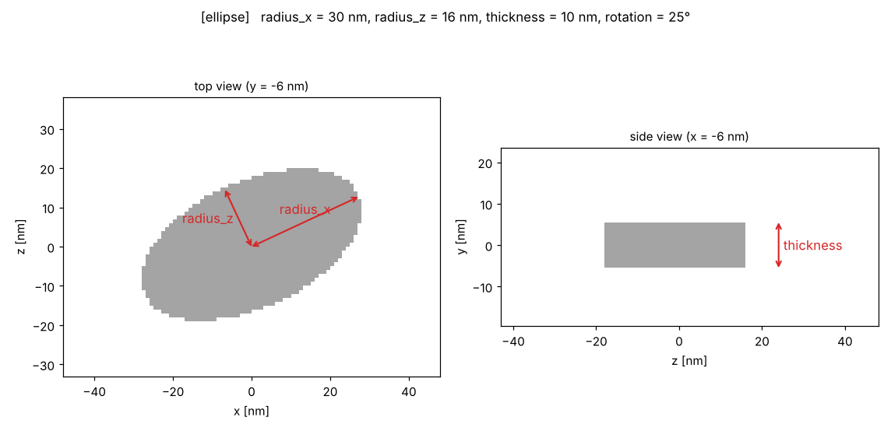

| key | meaning |
|---|---|
| `radius_x` | [m] semi-axis along x |
| `radius_z` | [m] semi-axis along z |
| `thickness` | [m] along y |
| `rotation` | [deg] positive turns counter-clockwise in the top view (x right, z up) |

## cylinder_3d

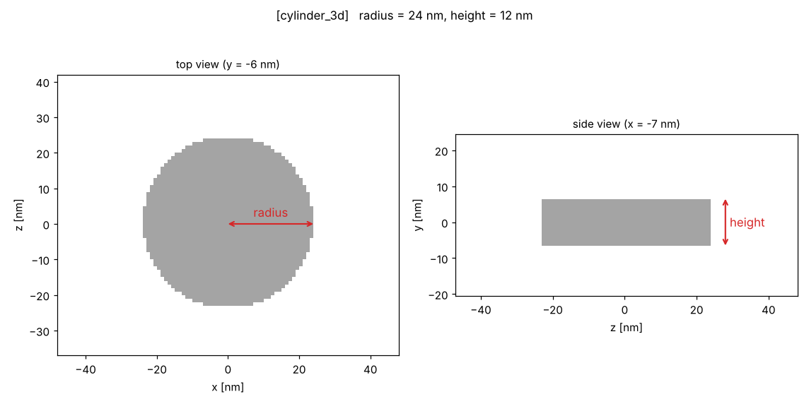

| key | meaning |
|---|---|
| `radius` | [m] disc in the x-z plane |
| `height` | [m] along y |

## dipole

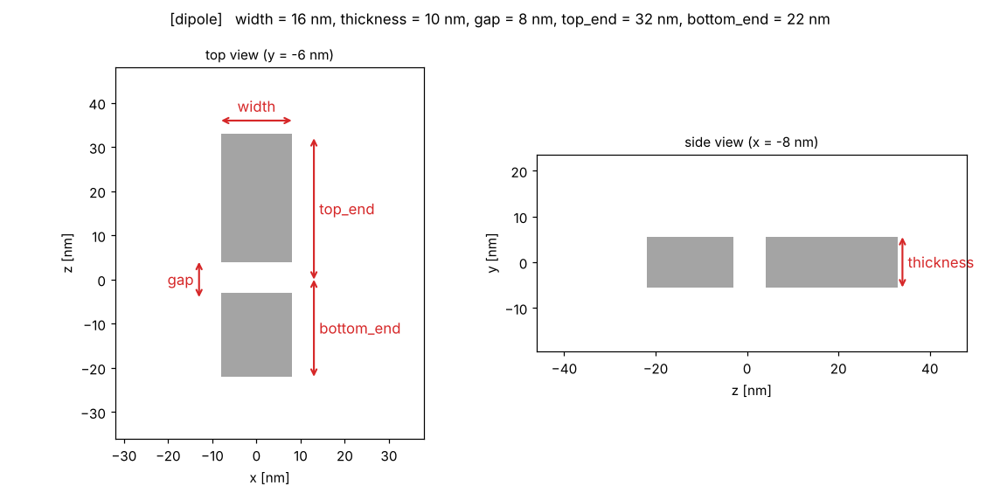

| key | meaning |
|---|---|
| `width` | [m] arm width, along x |
| `thickness` | [m] along y |
| `gap` | [m] between the arms, along z |
| `top_end` | [m] end of the top arm, measured from the centre of the gap (+z) |
| `bottom_end` | [m] end of the bottom arm, measured from the centre of the gap (-z) |

## bowtie

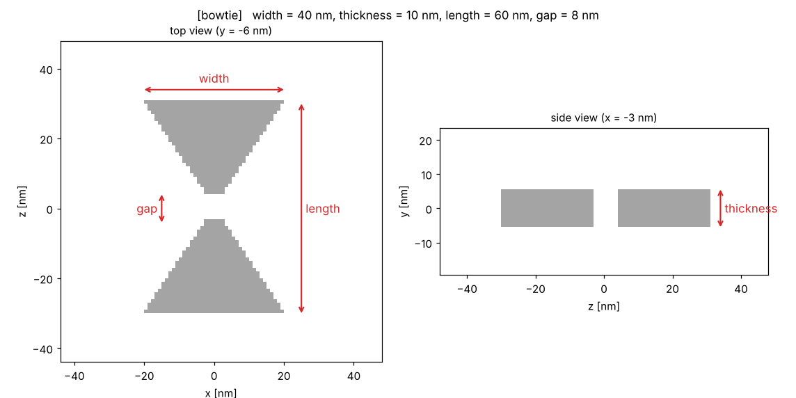

| key | meaning |
|---|---|
| `width` | [m] base of each triangle, along x |
| `thickness` | [m] along y |
| `length` | [m] base to base, along z |
| `gap` | [m] between the tips |

## triangle

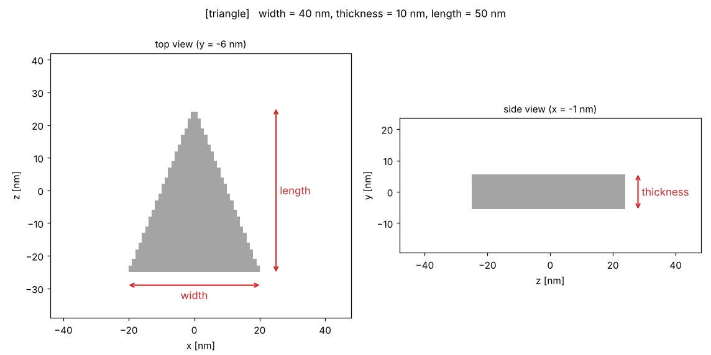

| key | meaning |
|---|---|
| `width` | [m] base, along x |
| `thickness` | [m] along y |
| `length` | [m] base to apex, along z |

## rounded_triangle

| key | meaning |
|---|---|
| `width` | [m] outer size along x |
| `thickness` | [m] along y |
| `length` | [m] outer size along z |
| `corner_radius` | [m] |

## rounded_monopole

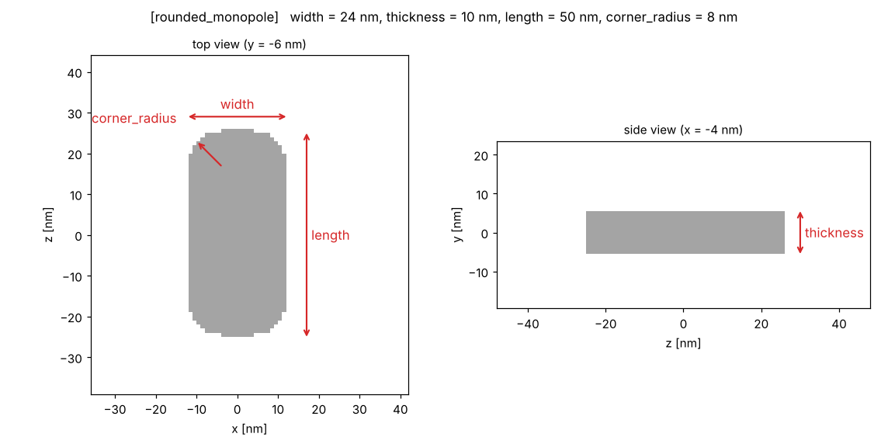

| key | meaning |
|---|---|
| `width` | [m] along x |
| `thickness` | [m] along y |
| `length` | [m] along z |
| `corner_radius` | [m] of the four vertical edges |

## rounded_dipole

| key | meaning |
|---|---|
| `width` | [m] arm width, along x |
| `thickness` | [m] along y |
| `length` | [m] of each arm, along z |
| `gap` | [m] between the arms |
| `corner_radius` | [m] of the vertical edges |

## rounded_dipole_offset_planes

| key | meaning |
|---|---|
| `width` | [m] arm width, along x |
| `thickness` | [m] along y |
| `length` | [m] of each arm, along z |
| `gap` | [m] between the arms |
| `corner_radius` | [m] of the vertical edges |

## round_dipole

| key | meaning |
|---|---|
| `width` | [m] arm width |
| `thickness` | [m] along y |
| `gap` | [m] between the arms |
| `top_length` | [m] length of the top arm |
| `bottom_length` | [m] length of the bottom arm |
| `corner_radius` | [m] of every edge |
| `rotation` | [deg] 0: arms along z; positive turns counter-clockwise in the top view (x right, z up) |

## one_side_round_dipole

| key | meaning |
|---|---|
| `width` | [m] arm width; the outer ends are half discs of this diameter |
| `thickness` | [m] along y |
| `gap` | [m] between the arms |
| `top_end` | [m] centre of the top end disc, measured from the centre of the gap |
| `bottom_end` | [m] centre of the bottom end disc, measured from the centre of the gap |
| `rotation` | [deg] 0: arms along z; positive turns counter-clockwise in the top view (x right, z up) |

## round_hybrid

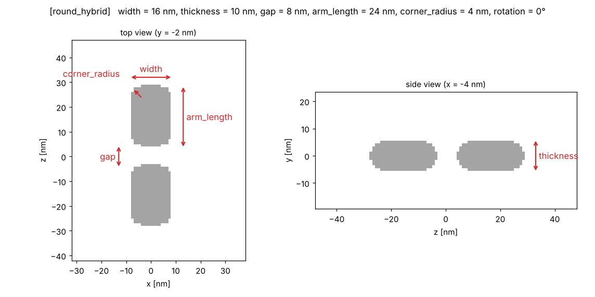

| key | meaning |
|---|---|
| `width` | [m] arm width |
| `thickness` | [m] along y |
| `gap` | [m] between the arms (filled with the gap material) |
| `arm_length` | [m] length of each arm |
| `corner_radius` | [m] of every edge |
| `rotation` | [deg] 0: arms along z; positive turns counter-clockwise in the top view (x right, z up) |

## hole

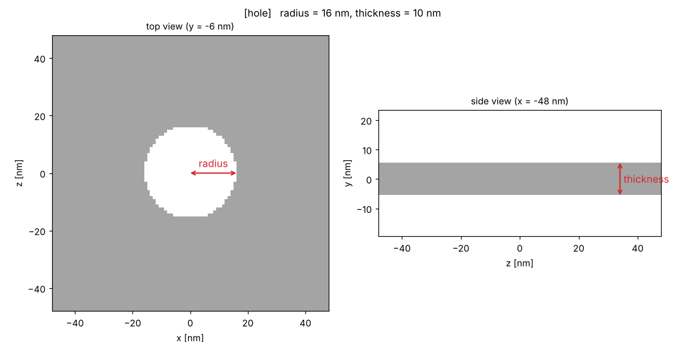

| key | meaning |
|---|---|
| `radius` | [m] of the hole |
| `thickness` | [m] of the film that fills the x-z plane, along y |

## u_shape

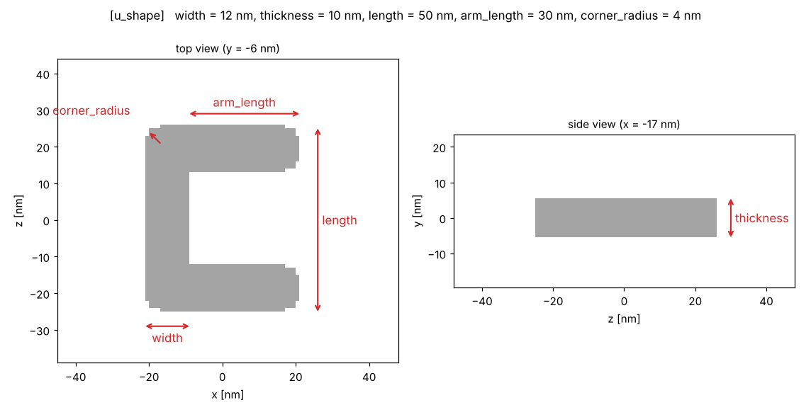

| key | meaning |
|---|---|
| `width` | [m] width of the three bars |
| `thickness` | [m] along y |
| `length` | [m] outer size along z |
| `arm_length` | [m] of the two arms along x, beyond the base bar |
| `corner_radius` | [m] |

## h_shape

| key | meaning |
|---|---|
| `width` | [m] width of the two bars, along x |
| `thickness` | [m] along y |
| `length` | [m] of the two bars, along z |
| `span` | [m] outer size along x |
| `bridge_width` | [m] size of the bridge along z |
| `corner_radius` | [m] |

## v_shape

| key | meaning |
|---|---|
| `width` | [m] arm width |
| `thickness` | [m] along y |
| `length` | [m] arm length |
| `corner_radius` | [m] |

## l_shape

| key | meaning |
|---|---|
| `width` | [m] arm width |
| `thickness` | [m] along y |
| `length` | [m] arm length |
| `corner_radius` | [m] |

## l_antenna

| key | meaning |
|---|---|
| `width` | [m] width of the two bars |
| `thickness` | [m] along y |
| `length_x` | [m] of the bar along x (at the -z end), from the outer corner to the centre of its round end |
| `length_z` | [m] of the bar along z (at the -x end), from the outer corner to the centre of its round end |

## lateral_dipole

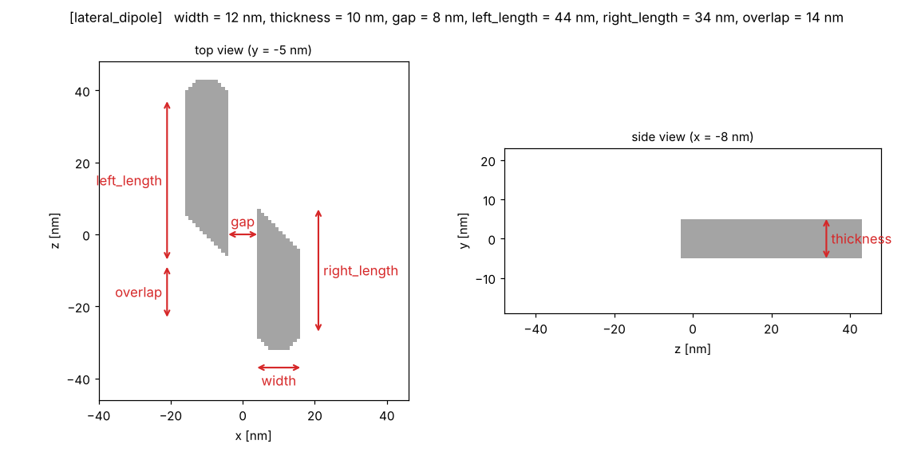

| key | meaning |
|---|---|
| `width` | [m] width of each bar, along x |
| `thickness` | [m] along y |
| `gap` | [m] between the two bars, along x |
| `left_length` | [m] of the bar at -x; it reaches toward +z |
| `right_length` | [m] of the bar at +x; it reaches toward -z |
| `overlap` | [m] length along z over which the two bars face each other; the facing corners are cut at 45 deg |

## round_butterfly

| key | meaning |
|---|---|
| `width` | [m] bar width |
| `thickness` | [m] along y |
| `gap` | [m] between the two halves; each half is one z bar and one x bar joined by a diagonal neck |
| `length_z` | [m] of each bar along z, measured from width / 2 off the centre |
| `length_x` | [m] of each bar along x, measured the same way |
| `corner_radius` | [m] of every edge and of the two arcs |
| `rotation` | [deg] 0: bars along x and z; positive turns counter-clockwise in the top view (x right, z up) |

## round_tripole

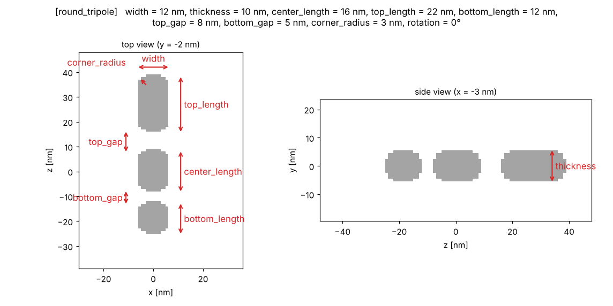

| key | meaning |
|---|---|
| `width` | [m] bar width |
| `thickness` | [m] along y |
| `center_length` | [m] of the middle bar; the three bars are in line |
| `top_length` | [m] of the top bar (+z at rotation 0) |
| `bottom_length` | [m] of the bottom bar |
| `top_gap` | [m] between the middle and the top bar |
| `bottom_gap` | [m] between the middle and the bottom bar |
| `corner_radius` | [m] of every edge |
| `rotation` | [deg] 0: bars along z; positive turns counter-clockwise in the top view (x right, z up) |

## x_shape

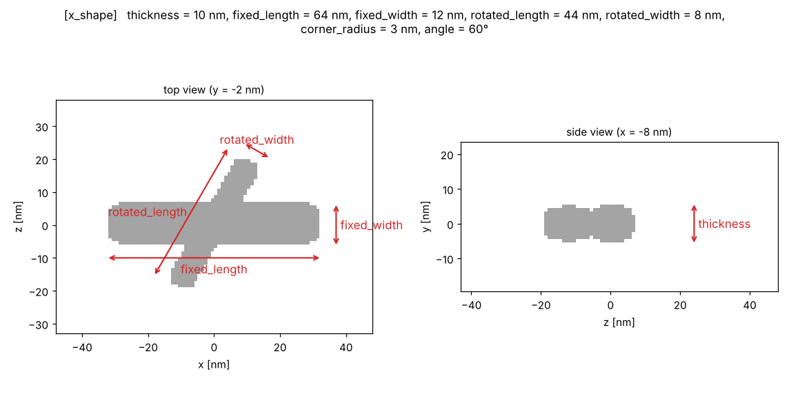

| key | meaning |
|---|---|
| `thickness` | [m] along y |
| `fixed_length` | [m] of the fixed bar, along x |
| `fixed_width` | [m] of the fixed bar |
| `rotated_length` | [m] of the second bar, which crosses the fixed one at its centre |
| `rotated_width` | [m] of the second bar |
| `corner_radius` | [m] of every edge |
| `angle` | [deg] from the fixed bar to the second bar, counter-clockwise in the top view (x right, z up); 90 is a cross |

## anapole

| key | meaning |
|---|---|
| `patch_edge` | [m] edge of the square patch |
| `thickness` | [m] film thickness along y |
| `corner_radius` | [m] fillet radius of the patch corners |
| `lobe_length` | length of the lobe curve, in units of patch_edge |
| `lobe_height` | height coefficient of the lobe curve, in units of patch_edge |
| `lobe_exponent` | exponent of the lobe curve |
| `lobe_offset` | where the lobe curve starts, from the patch centre, in units of patch_edge |
| `gap_length` | [m] gap between the lobes, along the lobe axis |
| `gap_width` | [m] gap across the lobe axis |
| `rotation` | [deg] in-plane rotation, x-z |
| `aperture_material` | fill of the whole aperture, lobes and gap, a material name; unset = background |
| `gap_material` | fill of the gap alone, a material name; unset = as the rest of the aperture |
| `lobe_points` | polygon vertices per lobe edge |

## two_films_spacer

| key | meaning |
|---|---|
| `thickness` | [m] of the film, along y |
