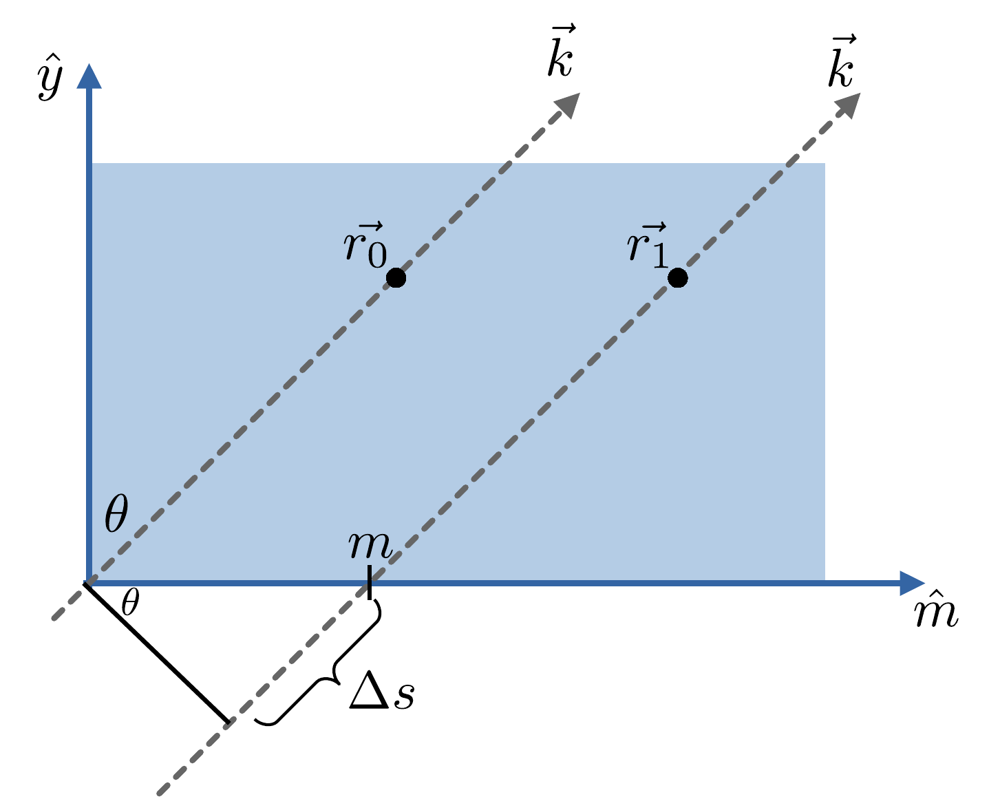
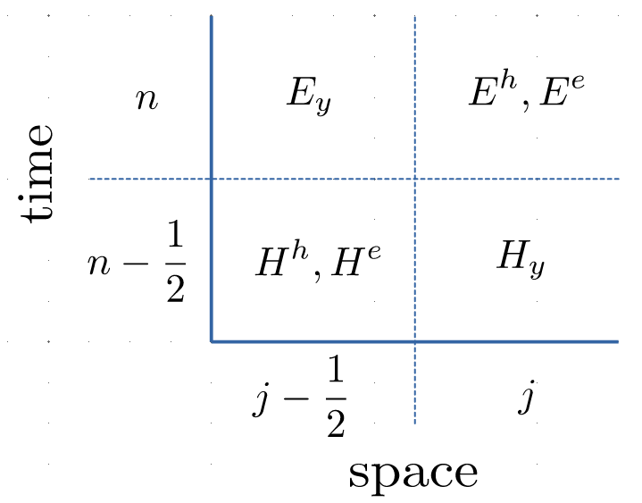

# Plane Wave Superposition with Media

## Concept 

This method can be used to inject a single or multiple plane waves at an arbitrary angle into a domain consisting of multiple media. With this method you can inject different beam shapes into a multilayered domain, e.g. a gaussian beam shape. It is activated automatically when the layers of `[geometry]` differ.

To accomplish this, a 1D simulation is run for each plane wave in a transformed coordinate system, before the actual 3D simulation. 
More details of the actual implementation are given below.

## How to Use

### Plane waves

Each wave is one `[wave.<name>]` section with `[source] type = wave_superposition`
([Plane Wave Superposition](PlaneWaveSuperposition.md)).

### Media

The media are the three layers of `[geometry]`, stacked along y:

```ini
[geometry]
first_medium = vacuum
middle_medium = film
middle_thickness = 200e-9
last_medium = glass

[material.film]
model = dielectric
n = 2.0

[material.glass]
model = dielectric
n = 1.45
```

### When the 1D simulations run

They run automatically when the layers are not all the same medium. To use the method in a
homogeneous domain as well, set

```ini
[wave_superposition]
layered_simulation = true
```

The log reports the 1D simulations as they run.

With many plane waves (a focused beam, for example) the pre-computed 1D fields can use a lot of
memory. `[source] aux_steps` limits how many time steps each 1D simulation computes at once; the
default `-1` is all of `[grid] time_steps`:

```ini
[source]
aux_steps = 50
```

A run that uses the 1D simulations cannot be continued from a state file
([Stopping and Restarting](../tutorial/Restart.md)).

## Implementation 

This implementation utilizes multiple classes to implement the functionality. The highest-level class is the `OneDimensionalSimulator` (`inc/sources/one_dim_simulator.h`).

When the method is active, a `OneDimensionalSimulator (ODS)` object is initialized with the layers and all plane waves of the configuration.

For each plane wave a `PlaneWaveOneDimensionalSimulator (PWODS)` object is initialized, which runs the 1D simulation for one particular plane wave. In this sense, the `ODS` orchestrates the mutliple `PWODS` objects. Both classes have very similar features, while the numerical equations are defined in `PWODS`.

On initialization the `PWODS` objects runs the 1D simulation for a defined number of time steps (as discussed above). The most important function is  `return_fields()`, which returns all three components of electric and magnetic fields at any given spatial location (in the 3D domain) and time.  If the fields are requested at a time which was not yet simulated the `PWODS` runs the 1D simulation further until the required time step is reached.

The fields that can be retrieved from the `return_fields()` function are used in `src/sources/oblique.cc`. Here the excitation follow the usual total-field/scattered-field approach to excite the plane wave in the 3D domain. Note that the `return_fields()` function is called from the `ODS` object which gathers the fields from all `PWODS` objects beforehand.

The explicit numerical equations that are implemented in the `propagate_timestep()` function are explained in the next section. It is important to note that the 1D simulations use a transformed coordinate system (in which I called the fields *update fields*). Hence, there exist transformation function between the cartesian fields and the update fields.

## Theoretical Background

The implementation of this method is based on the paper by *Ilker R. Capoglu* and *Glenn S. Smith*:

[*A Total-Field/Scattered-Field Plane-Wave Source for the FDTD Analysis of Layered Media*](https://ieeexplore.ieee.org/document/4427327).

More detailed descriptions can also be found in the [PhD Thesis of *Ilker R. Capoglu*](https://repository.gatech.edu/server/api/core/bitstreams/1b58f6dd-bce6-4c72-8a5a-e1b0d14a191d/content).

### Geometry 

In contrast to the paper above, our default propagation direction is the $y$-axis. The different media are also stacked along the $y$-axis (in the paper it is the $z$-axis). 

Consider a single incoming wave, with wave vector $\vec{k}$, which forms the *principal plane* $G$ together with the $y$-axis. We define the unit vector $\hat{m}$, normal to $\hat{y}$, on $G$ as:

$$ \hat{m} = \frac{\vec{k} - (\vec{k} \cdot \hat{y}) \hat{y}}{|\vec{k} - (\vec{k} \cdot \hat{y}) \hat{y}|} = m_x \hat{x} + m_z \hat{z}$$

The two coefficients $m_x, m_z$ can be defined as the following: 

$$ m_x = \frac{\hat{k} \cdot \hat{x}}{\sqrt{(\hat{k} \cdot \hat{x})^2 + (\hat{k} \cdot \hat{z})^2}}$$ 
and $m_z$ accordingly.

The third vector $\hat{n}$, which is orthogonal to the principal plane $G$ can be defined by the cross product: 

$$ \hat{n} = \hat{y} \times \hat{m} = (m_z, 0, -m_x)$$

Since we have only one plane wave $\vec{k}$ incident and $\hat{n}$ is orthogonal to the principal plane, the dynamics do not change in $\hat{n}$ direction. Thus all derivatives with respect to $\hat{n}$ evaluate to zero later on.

We define the *incident angle* $\theta$ with respect to the $y$-axis: 

$$ \theta = \sin^{-1}(\hat{k} \cdot \hat{y}) $$

### Reduction to 1D problem

Only the field evolution on the 2D principal plane is relevant, since the plane wave extends infinitely into $\hat{n}$ direction. Here we will reduce the problem further to a time-dependent 1D problem.

The phase velocity tangential to the surface of any medium is constant, due to continuity constraints. On the principal plane the $\hat{m}$-axis is parallel to the media surfaces. The phase velocity along $\hat{m}$ in the first medium is defined by: 

$$ v_{p_{m}} = \frac{\omega}{k_m} = \frac{\omega}{k \; \sin\theta} = \frac{c_0}{\sin \theta}$$

$c_0$ is here the phase velocity in the first medium. If we have vacuum as the first medium, it is the speed of light in vacuum.

In the following we consider two points $\vec{r_0} = (y, m_0)$ and $\vec{r_1} = (y, m_1)$  and some arbitrary incident plane wave $\vec{k}$. We derive a relation between the fields at the two locations. A sketch of the geometry on the principal plane is shown below.



From the geometry it is clear, that the plane wave reaches the point $\vec{r_1}$ later than the point $\vec{r_0}$, i.e. $E(\vec{r_1}, t ) = E(\vec{r_0}, t - t_d)$.

The time delay $t_d$ is due to the additional distance $\Delta s$, which the plane wave has to propagate. From the geometry we can derive that:

$$ \Delta s = m \; \sin \theta$$ 

With the phase velocity $c_0$ of the initial medium we find:

$$ t - t_d = t - \frac{m \; \sin \theta}{c_0} = t - \frac{m}{v_{p_m}} = \zeta$$

We have absorbed the dependency on $m$ into the time, by definining $\zeta$. If we use the $y$-axis as a reference for zero time delay, the fields on the principal plane only depend on $y$ and $\zeta$: $E(y, \zeta)$.

For later calculations it is important to define the derivatives with respect to $\zeta$ to replace the ordinary time derivatives. With the definition of $\zeta$ we can find:

$$ \frac{\partial E}{\partial t} = \frac{\partial E}{\partial \zeta} \quad \text{and} \quad \frac{\partial E}{\partial m} = \frac{-\partial E}{\partial \zeta} \frac{\sin \theta}{c_0} = \frac{- \partial E}{\partial t} \frac{\sin \theta}{c_0}$$

### Transformed Maxwell equations

We have transformed the cartesian coordinates to the new coordinate system: 

$$ (\hat{x}, \hat{y}, \hat{z}) \rightarrow (\hat{m}, \hat{n}, \hat{y})$$

I will describe everything here for the electric fields, but this applies equivalently to the magnetic fields.  

In the new coordinate system the components of the electric fields are $\vec{E} = (E_m, E_n, E_y)$, where

$$ E_m = m_x E_x + m_z E_z \quad \text{and} \quad E_n = m_z E_x - m_x E_z$$

The gradient becomes $\nabla = (\partial m, \partial n, \partial y)$. Note that all derivatives with respect to $n$ vanish, due to the symmetry of the problem. The derivative with respect to m was related to the time derivative in the previous section.

To be consistent with the paper by Capoglu and Smith, we split the fields in TE and TM modes. Therefore we define the fields $\{E^h = E_n , H^h = - H_m, H_y\}$ as the TE modes and $\{E^e = E_m, H^e = H_n, E_y\}$ as the TM mode.

Using this we can rewrite Maxwell's equations for our particular 1D problem and discretize it according to the FDTD scheme. More details about this process can be found in the mentioned papers. Here, I will just write down the equations for the TE mode:

$$
\begin{aligned}
\left.H^h \right|_{j+\frac{1}{2}}^{n + \frac{1}{2}} &= \left.H^h \right|_{j+\frac{1}{2}}^{n - \frac{1}{2}} - \frac{\Delta t}{\mu_0 \Delta y} \left[ \left.E^h\right|_{j+1}^n - \left.E^h\right|_j^n\right] \\[1.5em]
\left.E^h\right|_j^{n+1} &= \left.E^h\right|_j^n - \frac{\Delta t}{\epsilon_0 (\left.\epsilon_r\right|_j  - \left.\epsilon_r\right|_0 \, \sin^2 \theta) \Delta y} \left[ \left.H^h\right|_{j + \frac{1}{2}}^{n+\frac{1}{2}} - \left.H^h\right|_{j-\frac{1}{2}}^{n+\frac{1}{2}} \right] \\[1.5em]
\left.H_y\right|_j^{n+\frac{1}{2}} &= -\left.H_y\right|_j^{n-\frac{1}{2}} + 2 Y_0 \sqrt{\left.\epsilon_r\right|_0} \,\sin \theta \; \left.E^h\right|_j^n 
\end{aligned}
$$

The lower index ($j$) denotes the spatial index along the discretized $y$-axis and the upper index ($n$) the time index discretized in steps $\Delta t$.

These equations are relative straight forward to implement. In this code they are implemented in the function `propagate_timestep()` in the `PlaneWaveOneDimensionalSimulator` class.

### Total Field / Scattered Field Source

Equivalently to the 3D FDTD implementation, the implemented 1D simulation uses a TF/SF source to inject the plane waves into the domain. To accomplish this, a correction term is needed at a particular the spatial index, the total field / scattered field boundary. 

Assume that the boundary is present at index $r$. For the $H^h$ field, we have the following update equation: 

$$ \left.H^h\right|_{r-\frac{1}{2}}^{n+\frac{1}{2}}  = \left.H^h\right|_{r-\frac{1}{2}}^{n-\frac{1}{2}} - \frac{\Delta t}{\mu_0 \Delta y} \left[ \left.E^h\right|_r^n - \left.E^h\right|_{r-1}^n \right] $$

On the RHS of the equation, we have $\left.E^h\right|_{r-1}$ and $\left.H^h\right|_{r-\frac{1}{2}}$, which are located in the scattered field region of the domain. In contrast, the term $\left.E^h\right|_{r}$ is located in the total field region. Hence we have to subtract the incident field from this term, to make the equation valid in the scattered field region. The corrected equation looks like the following:

$$ \left.H^h\right|_{r-\frac{1}{2}}^{n+\frac{1}{2}}  = \left.H^h\right|_{r-\frac{1}{2}}^{n-\frac{1}{2}} - \frac{\Delta t}{\mu_0 \Delta y} \left[ \left.E^h\right|_r^n - \left.E^h\right|_{r-1}^n \right] + \frac{\Delta t}{\mu_0 \Delta y} \left. E^h_{inc} \right|_r^n$$

where $E^h_{inc}$ is the incident field that is defined by the injected plane wave. The time evolution of this field is given by the *signal function* $f(t)$, e.g. a Gaussian time profile. 

$$ \left. E^h_{inc} \right|_r^n = \left. E^h_{inc} \right|_r^0 \; f(n \Delta t) $$

For the fields $H^h, E^e, H^e$ the correction terms can be derived in similar ways. For the $y$-components no such correction terms are needed.

Note that we only have the TF/SF boundary on one side of the domain. We don't need to extract the incident field at the end. The fields are absorbed by the CPML boundaries at the end of the domain.

### Field Interpolations and timing relations

To implement the TF/SF source in the 3D domain, we need the fields at a certain location and time $(x,y,z,t)$. However, the exact location and timestep might not be aligned with the discretization of the 1D simulation. Thus, we need to interpolate the fields to estimate their values at the required fields. We do this by linear interpolations. Higher interpolation schemes could be applied to improve the accuracy of the method. 

To write down the interpolation scheme, we first need to know at which time and spatial steps we store each field. This becomes clear from the update equations that were derived earlier (again, full equations can be seen in the paper). The following figure shows at which steps (integer or half integer) the fields are stored.
<p align="center">

</p>

Consider we require the field $E^h(x,y,z,t)$ in the 3D domain. In the 1D domain, the field is only a function of $t$ (or as we called it before $\zeta$) and $y$. 

$$ E^h(x,y,z,t) = E^h(\zeta, y) \quad \text{with} \quad \zeta = t - (m_x x + m_z z) \frac{sin \theta}{c_0}$$

For the interpolation scheme, we first find the surrounding indices around the required spatial and time step.

$$
\begin{aligned}
j = \lfloor \frac{y}{\Delta y}\rfloor \; &\rightarrow \; j\Delta y \leq y \leq (j+1)\Delta y \\
n = \lfloor \frac{\zeta}{\Delta t} \rfloor \; &\rightarrow \; n \Delta t \leq \zeta \leq (n+1) \Delta t
\end{aligned}
$$

The linear time interpolation can be written as: 

$$ E^h(\zeta) = c^t_1 \left. E^h \right|^n + c^t_2 \left. E^h \right|^{n+1} \quad \text{with} \quad c^t_1 = \frac{(n+1)\Delta t - \zeta}{\Delta t} \quad \text{and} \quad c^t_2 = \frac{\zeta - n \Delta t}{\Delta t}$$

The linear space interpolation can be written as:

$$ E^h(y) = c^y_1 \left. E^h \right|_j + c^y_2 \left. E^h \right|_{j+1} \quad \text{with} \quad c^y_1 = \frac{(j+1)\Delta y - y}{\Delta y} \quad \text{and} \quad c^y_2 = \frac{y - j \Delta y}{\Delta y}$$

We can combine both interpolations to obtain the field at the required position and time:

$$ E^h(\zeta, y) = c^t_1 \left(c^y_1 \left. E^h \right|^n_j + c^y_2 \left. E^h \right|^n_{j+1}\right) + c^t_2 \left(c^y_1 \left. E^h \right|^{n+1}_j + c^y_2 \left. E^h \right|^{n+1}_{j+1}\right) $$

As mentioned before we have $E^h(\zeta,y) = E^h(x,y,z,t)$ and thus found the fields at the required 3D location.

Similar interpolation can be done for all other fields. Due to the storage at different spatial steps (i.e. integer or half-integer) the factors $c_i^{t/y}$ are slightly different for each field. 
For example the time coefficients for the $H^h$ field are:

$$ c_1^t = \frac{(n+\frac{1}{2}) \Delta t - \zeta}{\Delta t} \quad \text{and} \quad c_2^t = \frac{\zeta - (n-\frac{1}{2})\Delta t}{\Delta t}$$

These interpolations are implemented in the `return_fields()` function of the `PlaneWaveOneDimensionalSimulator` class.

### Transformed CPML equations

We need CPML cells at the beginning and end of the boundary to absorb all remaining fields. Most papers derived the CPML equations for cartesian coordinates. This is fine for the 3D FDTD algorithm, since we also use cartesian coordinates. However, in the described 1D simulations we use transformed coordinates and thus also the differential Maxwell equations are different. We need to take this transformation into account when implementing the CPML equations.

This derivation is based on the paper [Performance advantages of CPML over UPML absorbing boundary conditions in FDTD algorithm](https://ui.adsabs.harvard.edu/abs/2017JEE....68...47G/abstract) by *Gvozdic* and *Djurdjevic*.

As a basis we use the differential equations for the fields from the *Capoglu* paper (referenced at the beginning).
Here I will describe the derivation of the numerical equations for the $E^h$ field.

The differential equation for $E^h$ is given by:

$$ \frac{\partial E^h}{\partial t} = \frac{-1}{\epsilon_0 (\epsilon_r - \epsilon_{r_0} \sin^2 \theta)} \frac{\partial H^h}{\partial y}$$

To get to the numerical equations in the CPML region, we need to perform a Fourier transformations and change to stretched coordinates in a complex coordinate space. This is described in detail in the mentioned paper. 

In the numerical equation this leads to an auxiliary field $\psi_{E^h}$ for the $E^h$ field. 

$$ \left.E^h\right|_j^{n+1} = \left.E^h\right|_j^n - \frac{\Delta t}{\epsilon_0 (\left.\epsilon_r\right|_j  - \left.\epsilon_r\right|_0 \, \sin^2 \theta) } \left[ \frac{\left.H^h\right|_{j + \frac{1}{2}}^{n+\frac{1}{2}} - \left.H^h\right|_{j-\frac{1}{2}}^{n+\frac{1}{2}}}{k_y \Delta y} + \left.\psi_{E^h}\right|_j^{n+\frac{1}{2}} \right]$$

If you compare this equation to the previous update equation for $E^h$ (see above) the only difference is the $k_y$ and the auxiliary field $\psi_{E^h}$.

The auxiliary field also has a numerical update equation: 

$$ \left.\psi_{E^h}\right|_j^{n+\frac{1}{2}} = b_y \, \left.\psi_{E^h}\right|_j^{n-\frac{1}{2}} + c_y \; \frac{\left.H^h\right|_{j + \frac{1}{2}}^{n+\frac{1}{2}} - \left.H^h\right|_{j-\frac{1}{2}}^{n+\frac{1}{2}}}{\Delta y} $$

Note that the auxiliary field is only defined in the CPML region.
The factors are defined by:

$$
\begin{aligned}
b_y &= exp \left[ - \left( \frac{\sigma_y}{\epsilon_0 k_y} + \frac{\alpha_y}{\epsilon_0 }\right) \Delta t \right] \\[1.2em]
c_y &= \frac{\sigma_y}{k_y (\sigma_y + \alpha_y k_y)}(b_y - 1) \\[1.2em]
k_y &= 1 + (k_{y,max} - 1) \left(\frac{l}{d}\right)^m \qquad l: \, \text{PML loss depth with} \; 0 \leq l \leq d \\[1.2em]
\sigma_y &= \sigma_{y,max} \left( \frac{l}{d}\right)^m \qquad d: \, \text{PML thickness} \\[1.2em]
\alpha_y &= \alpha_{y,max} \left( \frac{d - l}{d} \right)^{m_a}
\end{aligned}
$$

Some coefficients can be chosen from a range to fit the scenario that is simulated. Here, I have hardcoded them to certain values within the range. For more details see the paper mentioned above.

$$
\begin{aligned}
m_a &= 1 \quad , \quad m = 3 \quad , \quad k_{y,max} = 10 \\[1.2em]
\sigma_{y,max} &= \frac{0.8 (m+1)}{Z_0 \Delta y \sqrt{\epsilon_r}\mu_{eff}} \\[1.2em]
\alpha_{y,max} &= 0.2
\end{aligned}
$$

Similar equations can be derived for $H^h, E^e, H^e$ with their own auxiliary fields. Note that (as for TF/SF injector) the fields $E_y, H_y$ don't require a CPML equation.